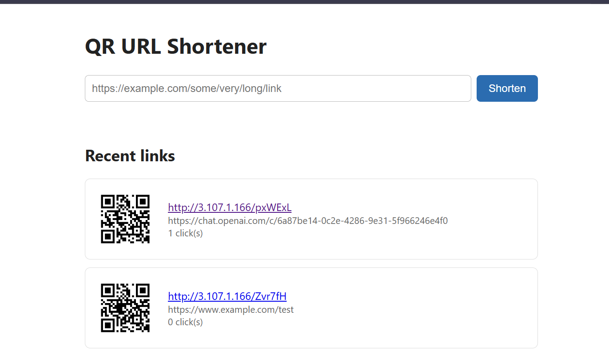
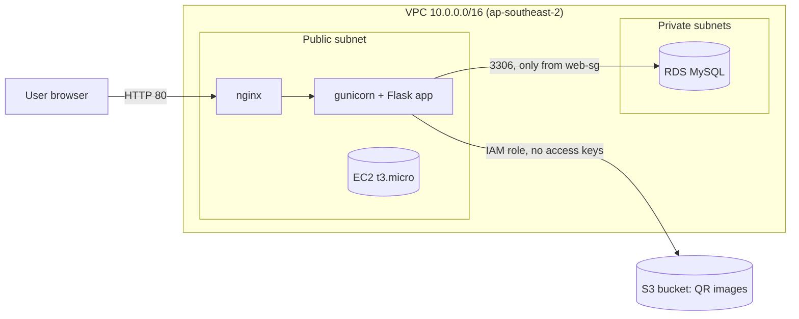
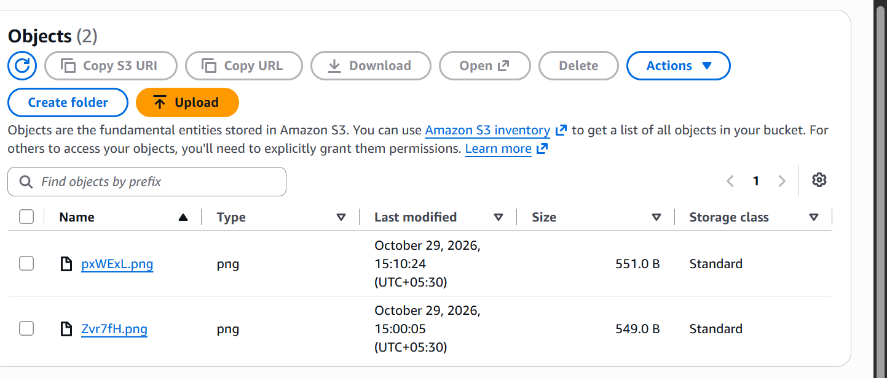

# QR URL Shortener on AWS

A web app that turns a long link into a short link and generates a QR code for it. Built and deployed by hand on AWS to learn core cloud services: **VPC, EC2, RDS (MySQL), S3 and IAM**.



## What it does

- Paste a long URL and get a short link such as `http://<server>/Zvr7fH`
- Visiting the short link redirects to the original URL and counts the click
- A QR code is generated for every short link and stored in a private S3 bucket
- Recent links, their QR codes and click counts are shown on the home page

## Architecture



| Piece | Role |
|-------|------|
| **VPC** | Private network with 2 public and 2 private subnets across 2 availability zones, and no NAT gateway |
| **EC2** | Runs nginx (front door) and gunicorn + Flask (the app), managed by a systemd service |
| **RDS MySQL** | Stores each short code, original URL, click count and creation time |
| **S3** | Stores the QR code PNG for each link in a private bucket |
| **IAM** | A role attached to the EC2 instance grants access to S3, with no access keys stored anywhere |
| **Security groups** | `web-sg` allows HTTP from anywhere and SSH from one IP. `db-sg` allows MySQL only from `web-sg` |

## Design decisions

- **Database in a private subnet with no public access.** The only way to reach MySQL is from the web server, because `db-sg` allows port 3306 only from `web-sg`.
- **IAM role instead of access keys.** The EC2 instance gets temporary credentials automatically, so there is nothing to leak.
- **Least-privilege policy.** The role can only read and write objects under the `qr/` prefix of one bucket.
- **Private S3 bucket with pre-signed URLs.** Public access is blocked. The app creates temporary links (valid for 1 hour) so the browser can show the QR images.
- **Secrets in environment variables.** Database credentials live in a `.env` file on the server that is excluded from Git.
- **No NAT gateway.** The database does not need internet access, so this avoids an unnecessary monthly cost.
- **Process management.** gunicorn runs as a systemd service with `Restart=always`, so the app starts at boot and recovers from crashes.

## API

| Method | Path | Description |
|--------|------|-------------|
| `GET` | `/` | Home page with the form and recent links |
| `POST` | `/shorten` | Body `{"url": "https://..."}`. Returns the short code, short URL and a QR image URL |
| `GET` | `/<code>` | Redirects to the original URL and increments the click count |
| `GET` | `/stats/<code>` | Returns the original URL and click count as JSON |
| `GET` | `/health` | Returns `{"status": "ok", "mode": "aws"}` |

Example:

```bash
curl -X POST http://<server>/shorten \
  -H "Content-Type: application/json" \
  -d '{"url": "https://www.example.com/some/very/long/link"}'
```

## Screenshots

**QR codes stored in the private S3 bucket**



<!-- Add more screenshots here, for example:


-->

## Run locally

The app falls back to SQLite and a local folder when no AWS settings are present.

```bash
python -m venv venv
source venv/bin/activate        # Windows: venv\Scripts\activate
pip install -r requirements.txt
python app.py
```

Open http://127.0.0.1:5000.

## Deploy on AWS (summary)

Region used: `ap-southeast-2` (Sydney).

1. **VPC:** create a VPC with 2 public and 2 private subnets in 2 availability zones, no NAT gateway
2. **Security groups:** `web-sg` (HTTP 80 from anywhere, SSH 22 from your IP) and `db-sg` (MySQL 3306 from `web-sg`)
3. **S3:** create a bucket with Block all public access turned on
4. **IAM:** create a policy allowing `s3:PutObject` and `s3:GetObject` on `arn:aws:s3:::<bucket>/qr/*`, and attach it to an EC2 role
5. **RDS:** create a MySQL `db.t3.micro` in a DB subnet group of the private subnets, public access off, security group `db-sg`, initial database name `shortener`
6. **EC2:** launch Amazon Linux 2023 in a public subnet with `web-sg` and the IAM role
7. **Server setup:**
   ```bash
   sudo dnf install -y git nginx python3-pip
   git clone <this repo> && cd <repo>
   python3 -m venv venv && source venv/bin/activate
   pip install -r requirements.txt
   ```
8. **Settings:** create `.env` from `.env.example` with the database host, password, bucket name and region
9. **Run:** create a systemd service for gunicorn and an nginx reverse proxy to `127.0.0.1:8000`

Configuration variables:

| Variable | Meaning |
|----------|---------|
| `DB_HOST` | RDS endpoint |
| `DB_USER` / `DB_PASSWORD` / `DB_NAME` | Database credentials and name |
| `S3_BUCKET` | Bucket for QR images |
| `AWS_REGION` | Region of the bucket |
| `BASE_URL` | Public address used in short links |

## Clean up

Delete in this order to stop charges: EC2 instance, RDS instance, S3 bucket (empty it first), security groups, then the VPC.

## Possible improvements

- Put the app behind an Application Load Balancer with HTTPS (ACM certificate) and a custom domain
- Auto Scaling group for the web tier, and Multi-AZ for the database
- CloudWatch alarms with SNS notifications
- Nightly database backup to S3
- Rebuild the infrastructure with Terraform or CloudFormation
- User login and per-user link history

## Tech stack

Python, Flask, gunicorn, nginx, MySQL (PyMySQL), boto3, qrcode, AWS (VPC, EC2, RDS, S3, IAM)
